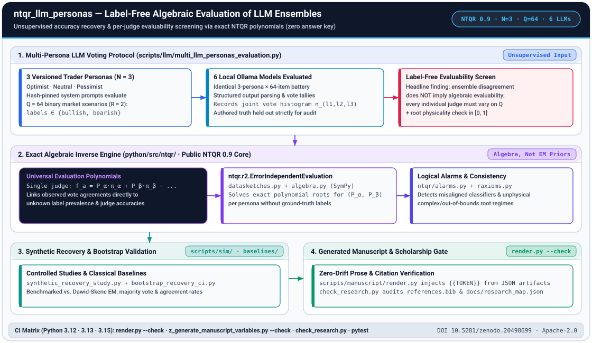

# ntqr_llm_personas — algebraic evaluation of LLM-persona ensembles

[](https://doi.org/10.5281/zenodo.20498699)
[](LICENSE)

Can you tell how accurate a group of noisy judges was on a test **without an
answer key** — using only their votes? **Algebraic evaluation** (the **NTQR**
logic) says yes: it builds *exact, universal* polynomials that link the observed
agreements and disagreements of an ensemble to the unknown statistics of its
correctness, turning evaluation into an inverse problem solved with algebra
rather than probability. Its distinctive safety value is that it can **warn you
when an ensemble is not good enough to be evaluated at all**.

This project tests that promise end to end on real local large language models,
and sharpens the warning into a quantitative, label-free diagnostic.
For publication metadata, the manuscript cites the public
[NTQR 0.9 release](https://pypi.org/project/ntqr/0.9/) as the package
authority. See [the migration notes](docs/ntqr09.md) for source provenance and local fixes.



## Documentation

Use Python 3.12 or later. To start without a model runtime, follow the
[recorded-vote verification guide](docs/VERIFICATION.md). It checks the
published analysis inputs and reruns the physical-solution audit on retained
votes.

- [Documentation index](docs/README.md) for setup, configuration, recorded evidence, and verification.
- [Study overview](docs/study.md) for the algebra, findings, and limits.
- [Manuscript and supplement](docs/manuscript/README.md) for the full study.
- [Reproduce the recorded study and render the paper](docs/rendering_pipeline.md).

## Cite

Archived on Zenodo — cite the **concept DOI** (always resolves to the latest
version): [`10.5281/zenodo.20498699`](https://doi.org/10.5281/zenodo.20498699).
The v1.0.0 record is [`10.5281/zenodo.20498700`](https://doi.org/10.5281/zenodo.20498700).
Machine-readable metadata lives in [`CITATION.cff`](CITATION.cff),
[`.zenodo.json`](.zenodo.json), and [`codemeta.json`](codemeta.json).

```bibtex
@software{friedman_ntqr_llm_personas_2026,
  author    = {Friedman, Daniel Ari},
  title     = {Recovering LLM-Persona Accuracies from Unlabeled Votes},
  year      = {2026},
  publisher = {Zenodo},
  version   = {1.0.0},
  doi       = {10.5281/zenodo.20498699},
  url       = {https://doi.org/10.5281/zenodo.20498699}
}
```
