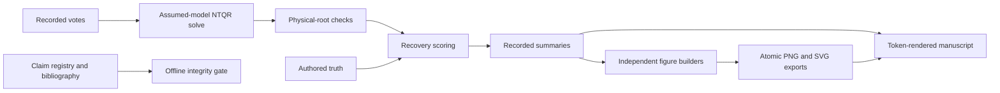

# Architecture — ntqr_llm_personas

## Overview

The project answers one question end to end: *can algebraic (NTQR) evaluation
recover how accurate a trio of LLM-persona judges was, from their votes alone,
with no answer key?* The software is organized as a **data pipeline** whose
terminal artifact is a *generated* manuscript — every number in the prose is
computed from the run, never typed by hand.

```
       python/src/ntqr/llm/personas.py      python/src/ntqr  (algebra)
            (3 personas × 64 scenarios)                 │
                     │  system prompts                  │
                     ▼                                  ▼
  Ollama  ──▶  scripts/llm/_llm.py  ──▶  votes  ──▶  ntqr/llm/analysis.py
 (6 models)    (cached per call)        (parsed,     (TrioLabelVoteCounts →
                     │                   never        ErrorIndependent /
                     │                   fabricated)   MajorityVoting /
                     ▼                                 Supervised evaluators)
        outputs/llm/multi_llm_personas_evaluation/             │
        ├── cache.json            (resumable vote cache)       ▼
        ├── models/<m>/*.json     (votes, diagnostics, recovery, comparison)
        ├── summary.json          (cross-model ranking + stats)   ◀── orchestrator
        └── *.png + *.svg + *.data.json   (10 method/LLM figures, each with a data sidecar)
                     │
                     ├──▶  scripts/sim/*.py
                     │     outputs/sim/          (bootstrap + synthetic checks)
                     │
                     └──▶  scripts/validation/statistical_validation_report.py
                           outputs/validation/   (claim-check matrix + figure)
                     │
                     ▼
   scripts/manuscript/_values.py  ── reads generated JSON artifacts ──────┐
   (single source of truth: dict[str,str] of every {{TOKEN}})            │
                     │                                                    │
                     ▼                                                    │
   scripts/manuscript/render.py  ── fills templates/*.md.tmpl ───────────┘
                     │  (fails loudly on unknown / leftover token)
                     ▼
   docs/manuscript/{manuscript,supplemental,README}.md   (GENERATED — do not edit)
```

## Layers

| Layer | Location | Responsibility |
|-------|----------|----------------|
| **Vendored library** | `python/src/ntqr/` | the algebraic-evaluation engine (`r2.evaluators`, `r2.datasketches`); installed editable into `.venv` |
| **Method harness** | `scripts/llm/`, `scripts/sim/`, `scripts/ntqr/`, `scripts/baselines/` | run the experiment: collect votes (or synthesise them), build evaluators, compute statistics, emit JSON + figures |
| **Validation report** | `scripts/validation/` | read generated artifacts and check the manuscript's load-bearing statistical claims without calling models or rerunning simulations |
| **Manuscript pipeline** | `scripts/manuscript/` | turn the JSON artifacts into a drift-proof generated manuscript |
| **Driver** | `scripts/run_all.py` | auto-discovers method categories; `llm` is opt-in (needs Ollama) |

The harness depends on the library; the manuscript pipeline depends only on the
JSON artifacts (never on the models or the network).

## The method modules (`scripts/llm/` + `python/src/ntqr/llm/`)

| File | Role |
|------|------|
| `python/src/ntqr/llm/personas.py` | the three personas (Optimist/Neutral/Pessimist) as system prompts; the 64 scenarios with authored truth; `CALL_TO_LABEL` / `LABEL_TO_CALL` |
| `scripts/llm/_llm.py` | `LLMClient` (Ollama backend), `preflight()`, per-call caching, `LLMUnavailable` |
| `python/src/ntqr/llm/analysis.py` | **pure numeric core** — no I/O, no plotting: response parsing, cache-record diagnostics, `build_label_counts`, `vote_variation`, `pairwise_disagreement`, `evaluability_diagnostic`, `build_comparison`, `recovery_stats`, `sampling_noise_floor` |
| `scripts/llm/_analysis.py` | thin collect-votes glue: prompt formatting, client calls with schema + repair retry, response-cache writes |
| `multi_llm_personas_evaluation.py` | the orchestrator: sweep the six models, run the three evaluators per model, rank by recovery MAE, write `summary.json` + ten method/LLM figures |
| `trader_personas_evaluation.py` | single-model variant of the same flow |
| `python/src/ntqr/llm/recovery_scoring.py` | **pure shared scoring core** — `safe_float`, `mean_accuracy`, `select_best` (the better-than-random tie-break), `accuracy_abs_errors`; reused by `analysis`, `simulation`, `bootstrap` |
| `python/src/ntqr/llm/simulation.py` | **pure synthetic harness** — generate error-(in)dependent votes for known-accuracy judges, solve through the *same* `ErrorIndependentEvaluation`, and sweep recovery-vs-`Q`, the alarm, the tie-break, ensemble robustness, and EI-vs-majority-voting; used by `scripts/sim/synthetic_recovery_study.py` (manuscript §3.7–3.9) |
| `python/src/ntqr/llm/bootstrap.py` | **pure scenario bootstrap** — resample the authored scenarios to put a CI on the real recovery MAE; used by `scripts/sim/bootstrap_recovery_ci.py` (§3.1) |

`ntqr.llm.recovery_scoring`, `ntqr.llm.analysis`, `ntqr.llm.simulation`, and
`ntqr.llm.bootstrap` are
deliberately pure so they can be unit-tested with **no network and no Ollama**
(`tests/test_{recovery,llm_analysis,simulation,bootstrap}.py`). The `scripts/sim/`
studies write to `outputs/sim/` and are fully deterministic.

## The validation report (`scripts/validation/`)

`statistical_validation_report.py` reads only generated JSON artifacts: the LLM
summary, the synthetic-study summary, the bootstrap summary, and figure
sidecars. It checks the paper's load-bearing claims as data constraints:
diagnostic predictions match solver outcomes, the real and bootstrap recovery
errors sit below the sampling-noise floor, synthetic recovery follows `1/sqrt(Q)`,
the alarm and tie-break regimes behave as claimed, EI and MV each win in their
proper regimes, and the plotted sidecars parse. Its outputs live in
`outputs/validation/statistical_validation/` and are rendered into manuscript
§3.10.

## The evaluators (`python/src/ntqr/r2/evaluators.py`)

| Class | Input | Output |
|-------|-------|--------|
| `ErrorIndependentEvaluation` | `TrioVoteCounts` (unlabeled) | prevalence quadratic → **two** solutions; per-label accuracies as linear functions of prevalence; `NaN` on a constant classifier; `PrevalenceImaginaryException` on error-correlation |
| `MajorityVotingEvaluation` | `TrioVoteCounts` | simpler unsupervised baseline (also two solutions) |
| `SupervisedEvaluation` | `TrioLabelVoteCounts` (labeled) | answer-key truth — used only to score recovery, never as solver input |

The formal algebra (data sketch, moments, the prevalence quadratic, the
evaluability proposition) is in the manuscript §2.5 and worked on real votes in
Supplemental §S1.5.

## Output contract

The LLM `summary.json` is the anchor artifact; its keys (`requested_models`,
`evaluated_models`, `failed_models`, `best_model`, `cross_model_statistics`,
`evaluability_diagnostic`, `ranking_by_recovery_mae`, `temperature`,
`n_scenarios`) are consumed by `_values.py`. The render also requires the
synthetic-study, bootstrap, and validation `summary.json` files. Each embedded
figure ships a JSON sidecar (`<stem>.data.json` where possible; named study
sidecars for shared synthetic sweeps) so every plotted value is
machine-readable.

## Build note

`pyproject.toml` declares an **empty package set**: this is a research harness
run from `scripts/`, not an importable distribution. Run everything with
`.venv/bin/python` directly (the vendored `ntqr` is the only editable install).
See [VERIFICATION.md](VERIFICATION.md).


## Composable publication and evidence layer



`visualization.py` exposes independent model-figure builders and a subset
orchestrator. `supporting_figures.py` handles simulation/bootstrap/validation
views. `study_records.py` loads the current recorded study status and input
hashes, and `validity_figure.py` renders the independent physical-solution audit.
`figure_export.py` and `artifacts.py` own publication and serialization.
`runtime_profile.py` owns performance evidence, and `scholarship.py` checks
bibliography/citation/claim-map integrity. The CLI scripts delegate to these
modules; offline figure generation never imports an LLM client.
