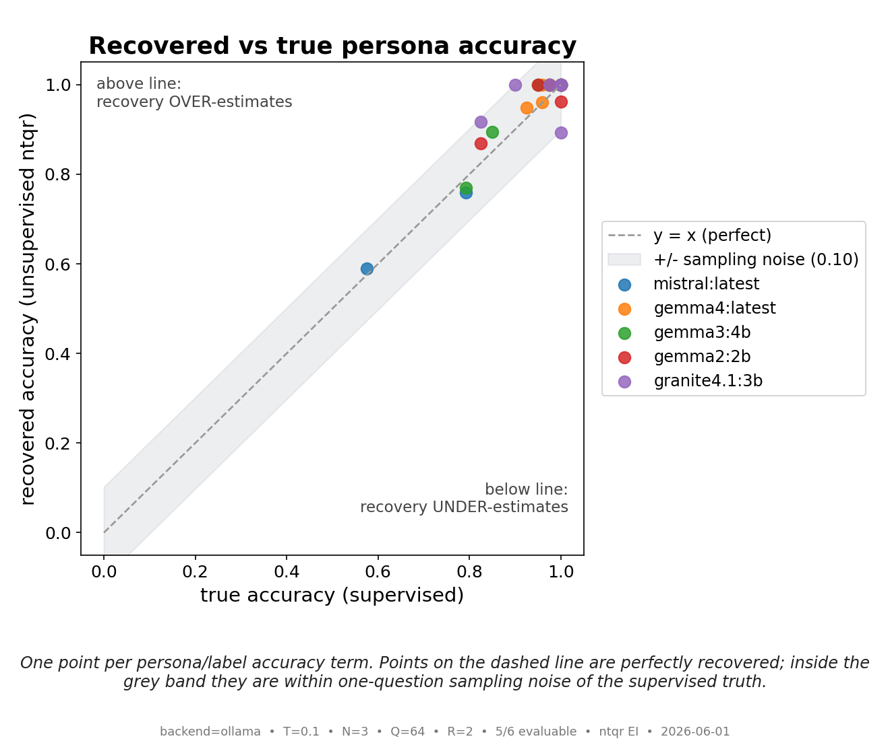
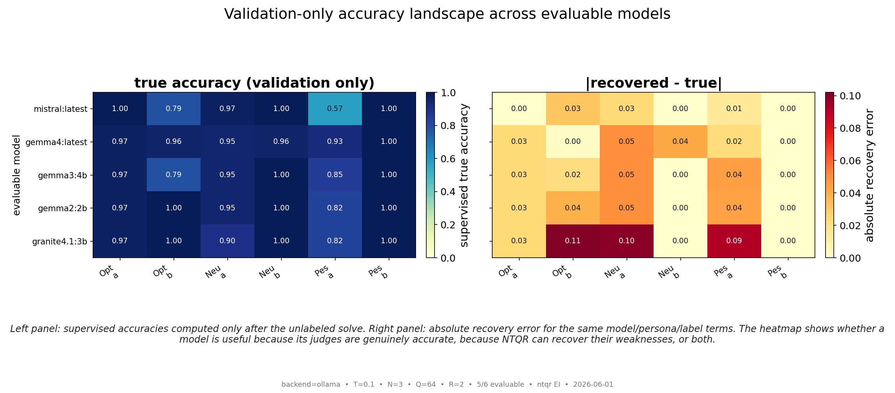
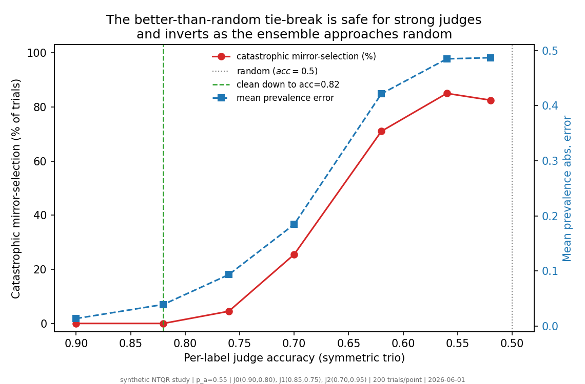
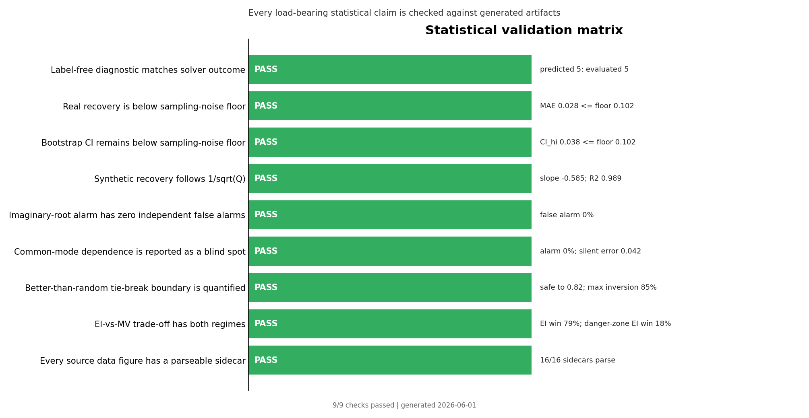

# Results {#sec:results}

## Unsupervised recovery works when the ensemble is well-behaved {#sec:recovery-result}

Among five evaluable models, mistral:latest recovered the authored truth most closely. Its unsupervised recovery tracked the authored truth to a mean absolute error of 0.012, within the 0.102 sampling-noise floor:

| Persona | Label | True | Recovered | Abs. error |
|---|---|---|---|---|
| Optimist | a | 1.0000 | 1.0000 | 0.0000 |
| Optimist | b | 0.7917 | 0.7600 | 0.0317 |
| Neutral | a | 0.9750 | 1.0000 | 0.0250 |
| Neutral | b | 1.0000 | 1.0000 | 0.0000 |
| Pessimist | a | 0.5750 | 0.5897 | 0.0147 |
| Pessimist | b | 1.0000 | 1.0000 | 0.0000 |

: Recovered vs. authored-truth per-persona, per-label accuracies for `mistral:latest`. The recovered columns use only votes; the truth columns are validation-only. {#tbl:recovery}

- **Recovery MAE = 0.012** (by label: `a` = 0.013, `b` =
  0.011) across six accuracy terms.
- **Prevalence**: true 0.625, recovered 0.609; absolute error
  **0.016**.

The most striking row is the Pessimist on label `a`: the pessimist was genuinely
*bad* at the bullish calls (true accuracy 0.57 — it called bearish even
when the facts were clearly bullish), and the unsupervised algebra recovered that
poor accuracy as 0.59 (against a true 0.57) — **with no answer key**. Unsupervised
evaluation is not merely detecting who is good; it is quantifying who is bad.
 At temperature 0.1 the recovery is close but not exact (recovery MAE 0.012, within the 0.102 sampling-noise floor); §3.5 and the limitations frame this as one stochastic draw, not a general guarantee.

{#fig:best-model-recovery width=95%}

{#fig:recovered-vs-true width=78%}

Across the five evaluable matrices, recovery MAE spans
**0.012-0.054** with median **0.024**
([@tbl:recovery-ranking]). This range is useful context: NTQR is not merely
ranking model quality, and a low recovery error does not mean every judge is
good. It means the algebra recovered the judges' strengths and weaknesses
faithfully. [@fig:validation-accuracy-heatmap] makes that distinction visible:
the left panel shows validation-only true accuracies, while the right panel
shows how much the unsupervised recovery missed each term by.

| Rank | Model | Recovery MAE | Max term error | Prevalence error | MV MAE | Validation role |
|---:|---|---:|---:|---:|---:|---|
| 1 | `mistral:latest` | 0.012 | 0.032 | 0.016 | 0.012 | best recovered matrix |
| 2 | `gemma4:latest` | 0.024 | 0.050 | 0.016 | 0.024 | evaluable comparison |
| 3 | `gemma3:4b` | 0.024 | 0.050 | 0.031 | 0.024 | evaluable comparison |
| 4 | `gemma2:2b` | 0.026 | 0.050 | 0.031 | 0.026 | evaluable comparison |
| 5 | `granite4.1:3b` | 0.054 | 0.107 | 0.062 | 0.054 | evaluable comparison |

: Recovery ranking across evaluable model matrices. The MAE columns are computed after the unsupervised branch is selected; the authored truth is used only to score validation error. {#tbl:recovery-ranking}

{#fig:validation-accuracy-heatmap width=95%}

**How stable is that number?** The recovery MAE is one figure from one finite
test, so we bootstrap it: resample the 64 scenarios with replacement and
re-run the *same* unsupervised solve on each resample (2000 resamples, no
new model calls). The point estimate is 0.012, with a 95% bootstrap
CI of **[0.000, 0.038]** for the recovery MAE and
[0.000, 0.047] for the prevalence error — the entire
interval sits well below the 0.102 sampling-noise floor ([@fig:bootstrap-recovery]). In
2% of resamples a persona happened to collapse to a constant
classifier and the solve was unavailable, a concrete measure of how the
evaluability condition (not the recovery accuracy) is the fragile part.

![Bootstrap distribution of the unsupervised recovery MAE over 2000 scenario resamples of `mistral:latest`. The point estimate (0.012) and the 95% CI [0.000, 0.038] both sit far below the 0.102 sampling-noise floor; 2% of resamples were degenerate.](../figures/bootstrap_recovery_mae.png){#fig:bootstrap-recovery width=90%}

## Failure modes: constant classifiers and non-compliance {#sec:failure-modes}

The other model collapsed at least one persona into a constant classifier:

| Model | Constant classifier(s) | Evaluable? |
|---|---|---|
| `granite4.1:3b` | — | **yes** |
| `mistral:latest` | — | **yes** |
| `gemma2:2b` | — | **yes** |
| `gemma3:4b` | — | **yes** |
| `gemma4:latest` | — | **yes** |
| `smollm2:135m-instruct-q4_K_S` | Optimist, Neutral, Pessimist | no |

: Per-model constant-classifier diagnostics. A model is evaluable only when every persona varies and every cell is parseable. {#tbl:constant-classifiers}

A capable model that follows a strongly-dispositioned persona prompt *too
rigidly* turns that persona into a judge who answers the same way every time.
A constant classifier carries no error signal, so the error-independent system
becomes unsolvable (it returns a degenerate / `NaN` solution). We report these
under `failed_models` with the offending persona named, rather than crashing the
sweep or emitting a `NaN` statistic. [@fig:evaluability-diagnostic] shows each
judge's modal-vote fraction per model; bars at 1.0 (red) are the
constant classifiers — you can read the failures straight off the votes.

{#fig:evaluability-diagnostic width=95%}

**Non-compliance (no fabricated votes).** At temperature 0.1, every model returned a parseable vote on all 192 persona calls -- no responses were unparseable, so no model was dropped for non-compliance.

| Model | Persona | Primary | Repaired | Parsed | Invalid | Modal | Entropy | Parser |
|---|---|---:|---:|---:|---:|---:|---:|---|
| mistral | Optimist | 1.000 | 0 | 64 | 0 | 0.703 | 0.877 | schema:64 |
| mistral | Neutral | 1.000 | 0 | 64 | 0 | 0.609 | 0.965 | schema:64 |
| mistral | Pessimist | 1.000 | 0 | 64 | 0 | 0.641 | 0.942 | schema:64 |
| gemma4 | Optimist | 1.000 | 0 | 64 | 0 | 0.625 | 0.954 | schema:64 |
| gemma4 | Neutral | 1.000 | 0 | 64 | 0 | 0.609 | 0.965 | schema:64 |
| gemma4 | Pessimist | 1.000 | 0 | 64 | 0 | 0.578 | 0.982 | schema:64 |
| gemma3 | Optimist | 1.000 | 0 | 64 | 0 | 0.688 | 0.896 | schema:64 |
| gemma3 | Neutral | 1.000 | 0 | 64 | 0 | 0.594 | 0.974 | schema:64 |
| gemma3 | Pessimist | 1.000 | 0 | 64 | 0 | 0.531 | 0.997 | schema:64 |
| gemma2 | Optimist | 1.000 | 0 | 64 | 0 | 0.609 | 0.965 | schema:64 |
| gemma2 | Neutral | 1.000 | 0 | 64 | 0 | 0.594 | 0.974 | schema:64 |
| gemma2 | Pessimist | 1.000 | 0 | 64 | 0 | 0.516 | 0.999 | schema:64 |
| granite | Optimist | 1.000 | 0 | 64 | 0 | 0.609 | 0.965 | schema:64 |
| granite | Neutral | 1.000 | 0 | 64 | 0 | 0.562 | 0.989 | schema:64 |
| granite | Pessimist | 1.000 | 0 | 64 | 0 | 0.516 | 0.999 | schema:64 |
| smollm2 | Optimist | 1.000 | 0 | 64 | 0 | 1.000 | -0.000 | schema:64 |
| smollm2 | Neutral | 1.000 | 0 | 64 | 0 | 1.000 | -0.000 | schema:64 |
| smollm2 | Pessimist | 1.000 | 0 | 64 | 0 | 1.000 | -0.000 | schema:64 |

: Prompt-health diagnostics by model and persona under prompt version `v3_binary_schema`. Model labels are compacted for PDF fit; the full model names appear in [@tbl:model-lineup] and in `summary.json`. Parse methods and entropy are derived from cached raw-response records. {#tbl:prompt-health}

{#fig:prompt-compliance width=95%}

The previous temperature 0.7 prompt contract is retained as a stress-test baseline: it parsed 947/1152 cells, whereas the current temperature 0.1 schema-constrained headline parsed 1152/1152. The comparison isolates interface compliance from the algebraic evaluability question. [@fig:temperature-schema-comparison] shows why the
low-temperature schema-constrained run replaces the temperature-0.7 prompt as
the headline experiment: parseability is now an interface check, while
evaluable vote matrices remain the scientific object.

{#fig:temperature-schema-comparison width=95%}

## Disagreement is *not* evaluability (the non-obvious result) {#sec:disagreement-not-evaluability}

The intuitive story -- "you need the judges to disagree" -- is incomplete. In this low-temperature schema run, aggregate disagreement happens to separate the groups: the one unevaluable model sat at 0.00, while the five evaluable models spanned 0.03–0.23. That separation is a symptom of the failed model's constant-classifier collapse, not the algebraic gate.

| Model | Mean pairwise disagreement | Evaluable? |
|---|---|---|
| `smollm2:135m-instruct-q4_K_S` | 0.00 | no |
| `gemma4:latest` | **0.03** | **yes** |
| `granite4.1:3b` | **0.06** | **yes** |
| `gemma2:2b` | **0.06** | **yes** |
| `gemma3:4b` | **0.10** | **yes** |
| `mistral:latest` | **0.23** | **yes** |

: Mean pairwise disagreement by model. Disagreement is not the evaluability gate; per-judge variation is. {#tbl:disagreement}

`smollm2:135m-instruct-q4_K_S` is unevaluable because one or more personas never varied, not because its ensemble-disagreement statistic fell below a universal threshold. The reason is structural: evaluability is
gated by a **per-judge** necessary condition (every judge must vary), not by an
**ensemble** quantity (how much the judges collectively disagree). A single judge
who never varies breaks the algebra no matter how loudly the rest of the ensemble
argues. Aggregate disagreement and per-judge variation are different axes, and
only the latter is necessary for a solution to exist. [@fig:disagreement-vs-evaluability]
plots the two axes against each other and shows the evaluable region is gated
horizontally (by per-judge variation), not vertically (by disagreement).

{#fig:disagreement-vs-evaluability width=95%}

## A label-free diagnostic predicts evaluability {#sec:diagnostic-result}

Because the binding condition is per-judge variation, it is detectable from the
votes alone. Our evaluability diagnostic — flagging any judge whose modal-vote
fraction is 1.0 — predicted `predicted_evaluable = True` for exactly
`gemma2:2b`, `gemma3:4b`, `gemma4:latest`, `granite4.1:3b`, `mistral:latest` and `False` for the other one. The ntqr solve then
evaluated exactly `mistral:latest`, `gemma4:latest`, `gemma3:4b`, `gemma2:2b`, `granite4.1:3b`. The prediction and the outcome agreed on all
six models (`diagnostic_matched_outcome = true`). The
diagnostic needs no answer key and no solve: it is computed directly from the
response matrix, making it a usable pre-flight "evaluation thermometer."

{#fig:scenario-hardness width=95%}

## Majority voting and error-independent recovery coincided here {#sec:mv-ei-real}

For mistral:latest, `MajorityVotingEvaluation` and `ErrorIndependentEvaluation` returned the same selected solution, so their recovery MAE was identical (0.012). This is a property of this particular, near-error-independent vote pattern rather than a general theorem; we report both so the comparison is visible per run.

Majority voting is included because it is the classical aggregation baseline:
Condorcet-style jury arguments justify it only when voters are independent and
better than random [@condorcet_jury_sep], and LLM self-consistency applies the
same intuition by sampling multiple reasoning paths and taking the modal answer
[@wang_2022_self_consistency]. NTQR asks a different question: not which label
wins, but whether the votes contain enough structure to estimate each judge's
accuracy.

## Reading the figure suite together {#sec:figure-suite}

The 16 embedded figures tell the paper's arc in one pass.
[@fig:evaluation-pipeline] fixes the data boundary: votes enter the
unsupervised solve, and authored truth enters only for validation.
[@fig:disagreement-vs-evaluability] is the thesis: evaluability separates along
the per-judge-variation axis, not the disagreement axis.
[@fig:best-model-recovery] and [@fig:recovered-vs-true] are the recovery result:
for the best evaluable model, recovered and true accuracies track each other
term for term (recovery MAE 0.012), while [@fig:recovery-mae-scorecard]
shows where every evaluable model sits. [@fig:evaluability-diagnostic] is the mechanism:
the red 1.0 bars are exactly the judges that broke the algebra.
The scorecard headline is: the five evaluable models sit at recovery MAE 0.012, within the 0.102 sampling-noise floor. Each
figure ships a `<stem>.data.json` sidecar carrying its exact series and
thresholds where applicable, so every plotted value is backed by a
machine-readable number. [@fig:validation-accuracy-heatmap] separates two
questions that should not be conflated: how accurate each judge actually was
after validation, and how accurately the unlabeled solve recovered that fact.
[@fig:prompt-compliance],
[@fig:temperature-schema-comparison], and [@fig:scenario-hardness] expose the
prompt interface and scenario difficulty that determine whether the algebra gets
a usable response matrix; the remaining simulation figures extend the same
logic through deterministic simulation, bootstrap uncertainty, the tie-break
boundary, and the EI-vs-MV trade-off.

{#fig:recovery-mae-scorecard width=90%}

## Synthetic validation: recovery scaling and the alarm's blind spot {#sec:synthetic-validation}

The five evaluable real models give a finite empirical ranking, not a population estimate. To test the algebra across *many* ensembles — and
to probe the failure detector directly — we ran a
deterministic companion study on **synthetic judges** whose ground truth is set
by construction (`scripts/sim/synthetic_recovery_study.py`; no network, fully
seeded, reproducible). A trio with prevalence 0.55 and per-judge
`(a, b)` accuracies (0.90, 0.80), (0.85, 0.75), (0.70, 0.95) is sampled under error-independence, its votes
are fed through the **identical** `ErrorIndependentEvaluation` used on the LLM
votes, and the unsupervised recovery is scored against the sample truth. We
average 200 independent draws at each test size.

**Recovery error falls like sampling noise.** As the test grows from
`Q = 32` to `Q = 4096`, the mean recovery MAE drops from
0.123 to 0.007 ([@tbl:synthetic-convergence]). A log–log fit of error
against `Q` has slope **-0.58** (R² = 0.989; the prevalence error
scales the same way, slope -0.55) — close to the −0.5 of an
unbiased, sampling-noise-limited estimator. So the algebra
carries no persistent bias: the only thing between the unsupervised recovery and
the truth is finite-sample noise, and the real `mistral:latest` result (recovery MAE
0.012 at `Q = 64`) sits squarely on this curve rather than being a
fortunate one-off.

| Q | Accuracy MAE | Prevalence error | Trials solved |
|---|---|---|---|
| 32 | 0.123 | 0.117 | 200/200 |
| 64 | 0.073 | 0.074 | 200/200 |
| 128 | 0.040 | 0.048 | 200/200 |
| 256 | 0.029 | 0.036 | 200/200 |
| 512 | 0.019 | 0.023 | 200/200 |
| 1024 | 0.013 | 0.016 | 200/200 |
| 2048 | 0.009 | 0.011 | 200/200 |
| 4096 | 0.007 | 0.008 | 200/200 |

: Synthetic recovery error vs. test size, averaged over 200 error-independent ensembles per row. Every draw solved cleanly — no spurious alarms. {#tbl:synthetic-convergence}

{#fig:synthetic-convergence width=90%}

**The scaling is not an artifact of one ensemble.** Repeating the convergence fit
across 4 deliberately different ensembles — varied prevalence
(0.50–0.70) and accuracy spread — keeps every fitted slope in a tight band
**[-0.60, -0.50]** around the ideal −0.5
([@tbl:synthetic-robustness]), so the sampling-noise-limited behaviour is a property of the algebra,
not of the particular judges we chose.

| Ensemble | Prevalence | Fitted slope | $R^2$ |
|---|---|---|---|
| balanced p=0.50 | 0.50 | -0.55 | 0.999 |
| tilted p=0.70 | 0.70 | -0.51 | 0.995 |
| strong p=0.55 | 0.55 | -0.50 | 0.997 |
| modest p=0.65 | 0.65 | -0.60 | 0.986 |

: The `1/√Q` convergence slope is stable across diverse ensembles, each fitted over the same `Q` grid. All slopes cluster near the ideal −0.5. {#tbl:synthetic-robustness}

**The alarm is sound but has a blind spot.** The error-independent solve carries
a built-in failure detector: when the prevalence quadratic's discriminant
`D = 1 − 4c/a` goes negative the prevalence root is imaginary — an answer-key-free
signal that error-independence is violated. We characterised it by injecting two
kinds of dependence at `Q = 1024` ([@tbl:synthetic-correlation],
[@fig:synthetic-alarm]). On genuinely
error-independent draws the alarm fired in **0%** of trials — no
false positives. An **anti-correlated** judge pair (which drives a pairwise
vote-moment negative) tripped it in up to **94%** of trials. But
positive **common-mode** correlation — all judges sharing a forced error, the
natural analogue of shared training data — never tripped it (**0%**),
even as it silently worsened the recovery it failed to warn about (prevalence
error rising from 0.016 under independence to
0.042 at the strongest common-mode setting).

| Error structure | Alarm fires | Mean $D$ | Recovery error (alarm silent) |
|---|---|---|---|
| independent | 0% | 0.0115 | 0.016 |
| common-mode 0.1 | 0% | 0.0080 | 0.014 |
| common-mode 0.2 | 0% | 0.0041 | 0.024 |
| common-mode 0.3 | 0% | 0.0021 | 0.034 |
| common-mode 0.4 | 0% | 0.0013 | 0.042 |
| anti-pair 0.2 | 0% | 0.0126 | 0.043 |
| anti-pair 0.3 | 40% | 0.0962 | 0.204 |
| anti-pair 0.4 | 94% | -0.0726 | 0.407 |

: Alarm-firing rate by error structure at `Q = 1024` (200 trials each). `D` is the mean prevalence discriminant; the last column is the recovery error on the trials where the alarm stayed silent. {#tbl:synthetic-correlation}

{#fig:synthetic-alarm width=95%}

This sharpens the safety claim honestly: the imaginary-prevalence alarm is a
*sufficient*, never-false-positive detector of violated error-independence, but
it is **not necessary** — the most realistic LLM failure, positively-correlated
errors from shared pre-training, is exactly the regime it can miss. The
per-judge evaluability diagnostic ([@sec:evaluability-diagnostic]) and this alarm are complementary
screens, and neither is a substitute for a held-out check when correlated errors
are plausible.

## The two-solution tie-break needs clearly-better-than-random judges {#sec:tiebreak-boundary}

Error-independent evaluation returns two mirror-image solutions; we pick the one
with higher mean accuracy ([@sec:tie-break]), the standard better-than-random assumption. That
assumption has teeth, and a synthetic sweep shows exactly where it loses them. We
hold the trio symmetric (so mean per-label accuracy is the only varying factor),
fix prevalence 0.60 and `Q = 256`, and slide the
accuracy from strong toward random ([@tbl:tiebreak], [@fig:synthetic-tiebreak]).
For strong judges the
tie-break is essentially flawless — **0%** catastrophic mirror-selection down to
accuracy **0.82** — but as the judges approach random the
mirror starts winning by chance and recovery inverts, reaching
**85%** catastrophic selections near accuracy 0.5. The
practical rule: algebraic recovery is trustworthy only for an ensemble that is
*clearly* better than random; a barely-better-than-chance jury can be confidently
and silently inverted.

| Judge accuracy | Catastrophic mirror-selection | Mean prevalence error |
|---|---|---|
| 0.90 | 0% | 0.014 |
| 0.82 | 0% | 0.039 |
| 0.76 | 4% | 0.093 |
| 0.70 | 26% | 0.185 |
| 0.62 | 71% | 0.421 |
| 0.56 | 85% | 0.485 |
| 0.52 | 82% | 0.487 |

: Catastrophic mirror-selection (prevalence error > 0.25) vs. mean judge accuracy at prevalence 0.60, `Q = 256`, 200 trials each. {#tbl:tiebreak}

{#fig:synthetic-tiebreak width=90%}

## Error-independent vs. majority-voting: exactness vs. robustness {#sec:mv-ei-synthetic}

[@sec:mv-ei-real] reported that on `mistral:latest` the error-independent (EI) and
majority-voting (MV) evaluators returned the same recovery — explicitly *"a
property of this particular vote pattern, not a general theorem."* The synthetic
harness settles the general question by running **both** evaluators on the same
draws across a prevalence × accuracy grid (`Q = 512`;
[@tbl:mv-ei], [@fig:synthetic-mv-vs-ei]). The answer is a clean trade-off,
not a winner:

- **EI is more accurate where its assumption holds.** For clearly-better-than-
  random judges the exact algebra beats majority voting — e.g. at prevalence
  0.55, accuracy 0.74, EI's recovery MAE is
  0.047 vs MV's 0.068 (1.43×
  lower), and EI wins on 79% of draws. MV is *biased* — it assumes
  the majority vote is the truth — so it cannot reach the exact answer.
- **MV is more robust where EI's assumption fails.** In the tie-break danger zone
  of [@sec:tiebreak-boundary] (weak judges, here accuracy 0.58 at prevalence
  0.70), EI's mirror inverts and its MAE explodes to
  1.098 while MV — which has no imaginary roots and no mirror —
  stays at 0.176; EI wins only 18% of draws.

The practical guidance mirrors the diagnostics of [@sec:evaluability-diagnostic]
and [@sec:tiebreak-boundary]: prefer the exact
algebra for an ensemble that clears the evaluability bar and is clearly better
than random, but keep majority voting as the robust fallback when those
conditions are in doubt — and report both, as we do per run.

| Prevalence | Judge accuracy | EI MAE | MV MAE | EI wins |
|---|---|---|---|---|
| 0.55 | 0.90 | 0.011 | 0.011 | 60% |
| 0.55 | 0.82 | 0.023 | 0.032 | 83% |
| 0.55 | 0.74 | 0.047 | 0.068 | 79% |
| 0.55 | 0.66 | 0.841 | 0.116 | 61% |
| 0.55 | 0.58 | 1.235 | 0.176 | 25% |
| 0.70 | 0.90 | 0.012 | 0.013 | 65% |
| 0.70 | 0.82 | 0.027 | 0.031 | 66% |
| 0.70 | 0.74 | 0.059 | 0.065 | 64% |
| 0.70 | 0.66 | 0.357 | 0.113 | 47% |
| 0.70 | 0.58 | 1.098 | 0.176 | 18% |
| 0.85 | 0.90 | 0.018 | 0.019 | 61% |
| 0.85 | 0.82 | 0.041 | 0.037 | 50% |
| 0.85 | 0.74 | 0.096 | 0.063 | 45% |
| 0.85 | 0.66 | 1.589 | 0.109 | 25% |
| 0.85 | 0.58 | 1.432 | 0.173 | 20% |

: Error-independent vs. majority-voting recovery MAE across a prevalence × accuracy grid (`Q = 512`, 200 trials per cell). "EI wins" is the fraction of draws where the exact algebra's MAE was lower. {#tbl:mv-ei}

{#fig:synthetic-mv-vs-ei width=95%}

## Statistical validation matrix {#sec:validation-matrix}

The manuscript's main claims are checked by a generated validation report rather
than by prose alone. `scripts/validation/statistical_validation_report.py` reads
the LLM summary, simulation summaries, bootstrap summary, and figure sidecars;
it does not call models or rerun experiments. The report currently passes
**9/9** checks, covering the real
recovery scale, label-free diagnostic, bootstrap uncertainty, synthetic
convergence, alarm behavior, tie-break boundary, EI-vs-MV trade-off, and figure
sidecar completeness.

| Check | Result | Evidence |
|---|---|---|
| Label-free diagnostic matches solver outcome | PASS | predicted 5; evaluated 5 |
| Real recovery is below sampling-noise floor | PASS | MAE 0.028 <= floor 0.102 |
| Bootstrap CI remains below sampling-noise floor | PASS | CI_hi 0.038 <= floor 0.102 |
| Synthetic recovery follows 1/sqrt(Q) | PASS | slope -0.585; R2 0.989 |
| Imaginary-root alarm has zero independent false alarms | PASS | false alarm 0% |
| Common-mode dependence is reported as a blind spot | PASS | alarm 0%; silent error 0.042 |
| Better-than-random tie-break boundary is quantified | PASS | safe to 0.82; max inversion 85% |
| EI-vs-MV trade-off has both regimes | PASS | EI win 79%; danger-zone EI win 18% |
| Every source data figure has a parseable sidecar | PASS | 16/16 sidecars parse |

: Offline validation checks for the manuscript's load-bearing claims. Each row is computed from generated JSON artifacts, not hand-audited numbers in prose. {#tbl:validation-matrix}

{#fig:validation-matrix width=95%}
